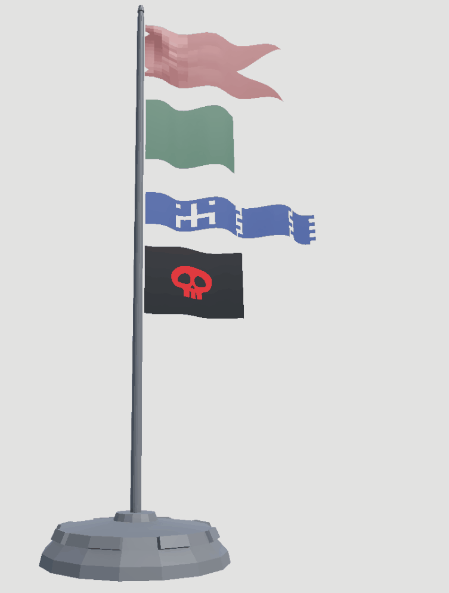
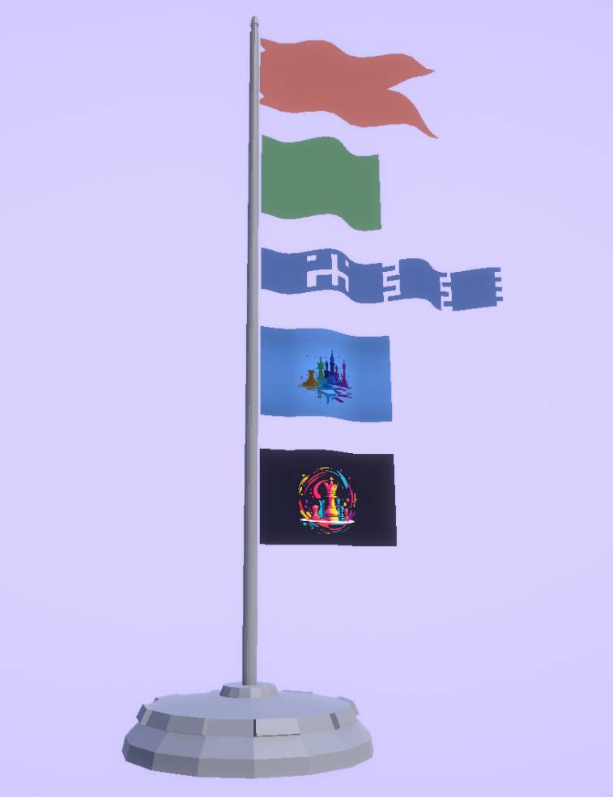

# Flag

## 📥 Installation (UPM / Git URL)

In Unity: **Window → Package Manager → + → Install package from git URL…**

```
https://github.com/cholushkin/flag.git
```

No manual Git dependencies are required — `Runtime/` has no dependency on
`ScriptUtils` or any other package.

## 📦 What this package is

This is a small, mostly standalone-demo project; the installable package is
just three `MonoBehaviour` utilities in `Runtime/` (`Rotate`,
`ColorPropertyOverride`, `TexturePropertyOverride`) plus a `Samples~/FlagDemo`
sample containing the flag FBX models, URP shadergraph materials, prefabs and
sample scene that showcase them. `ArtSources/` (the Blender source file),
`UserScripts/ExportFbxFlag.py` (the Blender→FBX export script) and
`doc-assets/` remain at the repo root as supporting source/tooling — they are
not part of the installable UPM package. `ScriptUtils` is a git submodule used
by that export tooling only, not by the runtime scripts.

## Demo

This demo project demonstrates the following key features:

* **Exporting models using a Python script**

  * See `ScriptUtils\Config\readme.md` for setup instructions.
  * Add your configuration with the following fields:

    ```json
    {
      "unity_project_root": "Unity/Flag",
      "blender_path": "your_path_to_blender"
    }
    ```

* **Shader Graph implementation for a flag effect**

  * `LitFlag`: A simple lit shader using a color tint
  * `LitFlagTexture`: A version that combines texture sampling with color tinting


## Features

* 🚩 **No cloth simulation** — uses a lightweight shader-based waving effect (faster and more GPU-friendly)
* 🧭 **Works in object space** — the flag animation remains consistent even when the object is rotated
* 🎨 **Color and Texture support via `MaterialPropertyBlock`** — allows dynamic per-object coloring & texturing without duplicating materials (ideal for batching and memory efficiency)






## Tags

Unity Shader Graph, Flag Shader, Shader Animation, MaterialPropertyBlock, Unity Export Blender, Blender to Unity, GPU Efficient Animation, Unity Object Space, Unity Shader Demo, Unity Procedural Animation, Lightweight Shader, Unity Tint Texture, Unity Shader Graph Texture Color, Unity Shader Graph Flag
